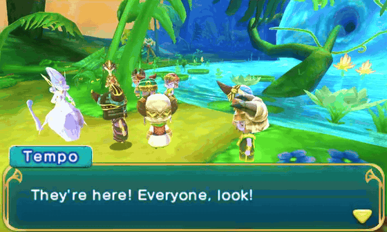

# Ever Oasis: Triumphant Ending

A happy-ending mod for a legally owned English US v0 copy of *Ever Oasis*.
The original final-boss encounter is preserved, followed by reunion, a warm
homecoming, sunny blue sky and the game's own credits.



*A short montage from the current v221 ending.*

## Download v221 preview

[Download the Windows xdelta ZIP](ever-oasis-triumphant-ending-v221-DIAGNOSTIC-public-preview-xdelta.zip?raw=true) (9.4 MiB).

No Python installation or extracted RomFS is required. Extract the entire ZIP,
then drag your matching clean game image onto `apply_patch.bat`.

This preview includes smoother character animation, shared community
conversation shots, and clear sunny weather in the final outdoor gathering.

## Validation status

| Check | Result |
| --- | --- |
| Patch application | Applied to the required clean image and reproduced the verified output byte-for-byte. |
| Windows launcher | Success, wrong-input rejection and existing-output protection tested. |
| Azahar 2126.0-alpha1 | Standalone patched-image boot and shrine entry checked; a complete boss-free v221 ending preview was reviewed through credits. |
| Authentic final-boss run of this package | Pending. |
| Real Nintendo 3DS | Not checked. |

This download is explicitly a **diagnostic preview**, not a hardware-qualified
release. The development test suite passed 337 tests with five skipped.
Back up your save before testing.

## Required clean image

Use a legally owned, clean, decrypted English US v0 `.3ds` or `.cci` image.

```text
Title ID: 00040000001A4800
SHA-256: A8EC061AD09A29AFD552C9DEDC836E7A8B355ED3A0C69ACC47A78BED63A78687
Size: 860,192,768 bytes
```

The launcher rejects other images, including other regions, updates, modified
images and differently trimmed dumps. The original source is read-only.

## Apply

1. Download the ZIP and extract all its files together.
2. Drag the matching clean `.3ds` or `.cci` onto `apply_patch.bat`.
3. Wait for the source check, patch application and output verification.
4. Open `Ever Oasis - Triumphant Ending v221-DIAGNOSTIC-public-preview.3ds` in Azahar.

A separate patched image is created beside the source. Existing output files
are preserved; rename an old output before applying again.

## Verified output

```text
SHA-256: 3973C0E1451783F5BFDE712A61F0CF3CC740EE7F4061BBD43D31FAF2D3D7AEFA
Size: 862,081,024 bytes
ZIP SHA-256: C1F9B52AF45280C48A06A7CE9CD27D6AF01CEACC61212BC0DD6AD912CA5AD262
```

The ZIP contains the xdelta, Windows launcher, checksums, xdelta3 utility,
license and corresponding xdelta3 source. It contains no game image or review
recording. Do not redistribute the patched game image.
